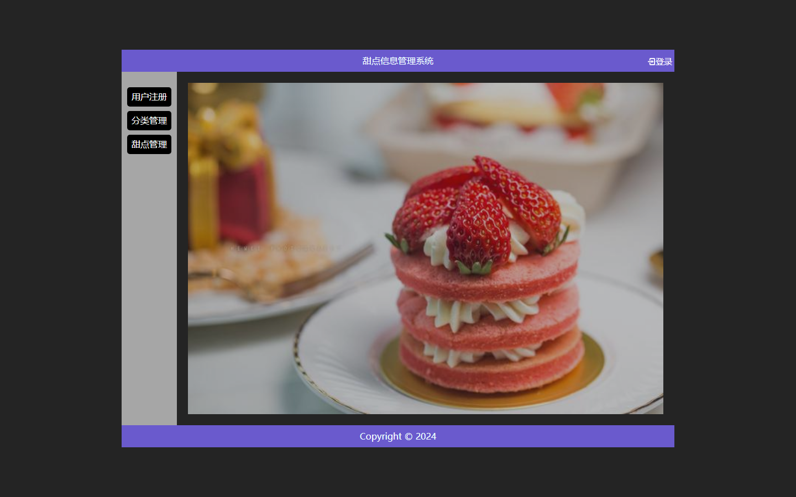
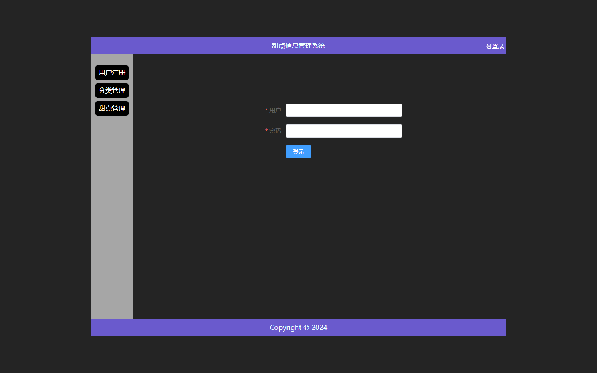
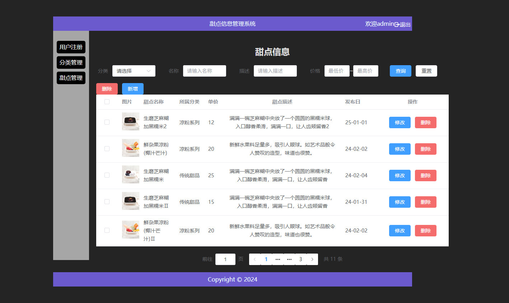

# 甜点信息管理系统

一个前后端分离的甜点信息管理系统,支持甜点和分类的增删改查、条件分页查询、图片上传,以及基于 JWT 的登录鉴权。

## 技术栈

- 后端:Spring Boot 3 + MyBatis + PageHelper + MySQL
- 前端:Vue 3 + Vite + Element Plus + Axios
- 鉴权:JWT(JSON Web Token)

## 目录结构

```
├── backend/        Spring Boot 后端
│   ├── src/
│   └── target/     打包好的 jar
├── frontend/       Vue 3 前端
├── sql/            数据库脚本
├── photo/          甜点图片(也是上传目录)
├── docs/           运行截图
├── start-backend.bat
└── start-frontend.bat
```

## 运行截图

**首页**



**登录**



**甜点管理**



## 运行方式

### 1. 准备数据库

需要本机装有 MySQL 8,然后导入脚本(会创建 desserts 库):

```
mysql -uroot -p < sql/desserts.sql
```

后端数据库配置在 `backend/src/main/resources/application.properties`,
默认账号 `root`、密码 `123456`,不一样的话自己改。

### 2. 启动后端

双击 `start-backend.bat`,或在 backend 目录执行:

```
java -jar target/prj-backend-0.0.1-SNAPSHOT.jar
```

用源码跑也可以:IDEA 打开 backend,运行 `com.example.prjbackend.App`(需要 JDK 17+)。

> 注意:启动时的工作目录要在 backend 下,因为图片映射用的是相对路径 `../photo/`。

### 3. 启动前端

双击 `start-frontend.bat`,或在 frontend 目录执行:

```
npm install
npm run dev
```

浏览器打开 http://localhost:5173

### 4. 登录

| 账号 | 密码 |
| --- | --- |
| admin | 12345 |
| bob | 123 |

不登录只能看首页,进管理页会被拦截到登录页。

## 功能

- 用户注册、登录(JWT,token 过期自动续期)
- 分类管理:增删改查
- 甜点管理:增删改查、按分类/名称/描述/价格区间组合查询、分页、图片上传
